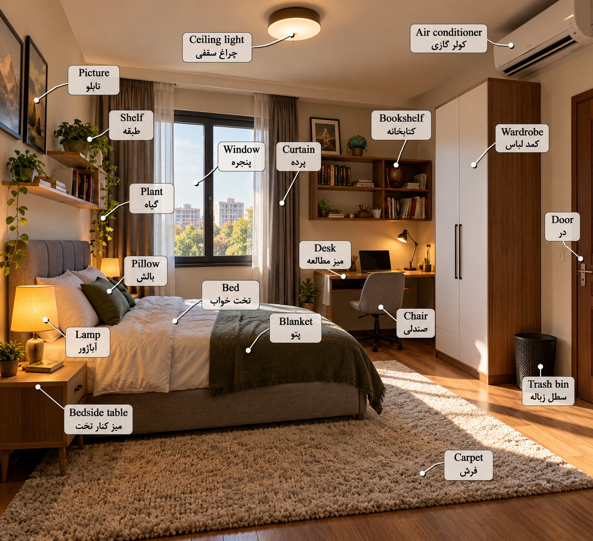
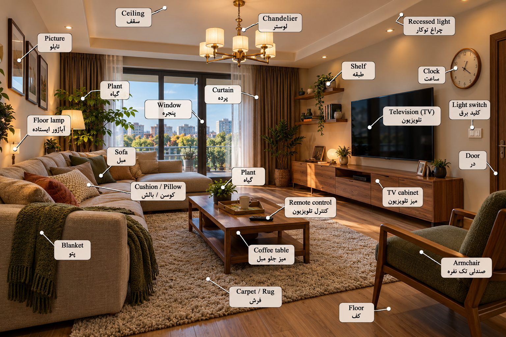
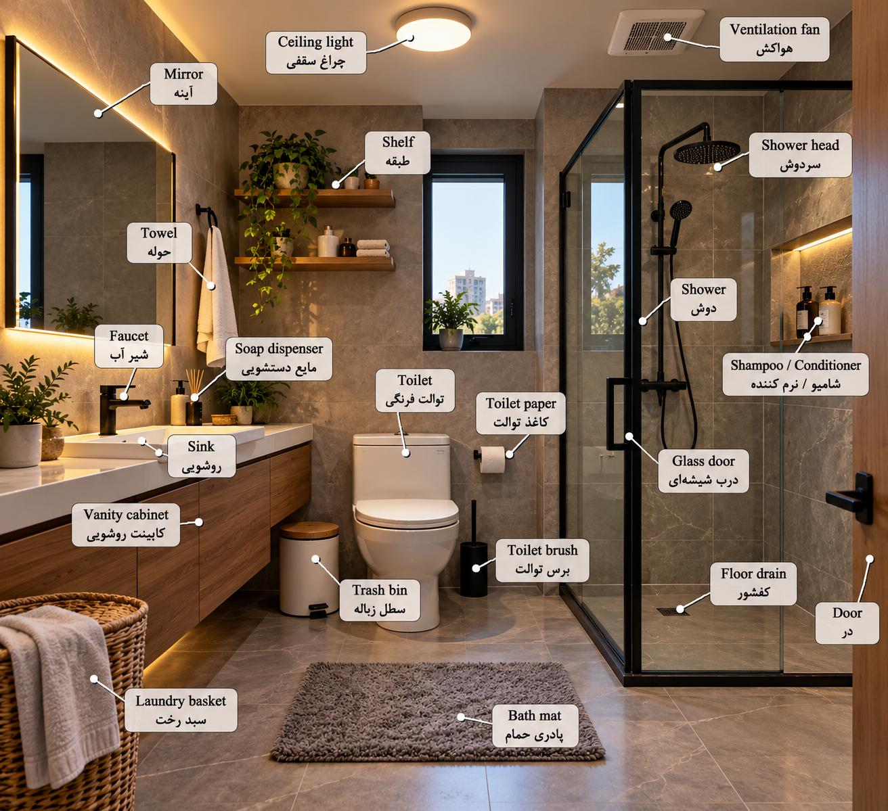

# Location
---
## bedroom vocabulary

	

این هم تمام کلمات مربوط به **اتاق خواب (Bedroom)** که در عکس اول داشتیم، همراه با تلفظ فارسی و معنی انگلیسی.

### 🛏️ Bedroom Vocabulary | لغات اتاق خواب

|شماره|کلمه انگلیسی|تلفظ فارسی|معنی فارسی|
|---|---|---|---|
|1|Bedroom|بِدروم|اتاق خواب|
|2|Bed|بِد|تخت خواب|
|3|Pillow|پیلو|بالش|
|4|Blanket|بِلَنکِت|پتو|
|5|Bedside table|بِدساید تِیبِل|میز کنار تخت|
|6|Lamp|لَمپ|چراغ / آباژور|
|7|Carpet|کارپِت|فرش / موکت|
|8|Window|ویندو|پنجره|
|9|Curtain|کِرتِن|پرده|
|10|Wardrobe|واردروب|کمد لباس|
|11|Door|دور|در|
|12|Desk|دِسک|میز تحریر / میز مطالعه|
|13|Chair|چِر|صندلی|
|14|Bookshelf|بوک‌شِلف|کتابخانه|
|15|Shelf|شِلف|قفسه / طبقه|
|16|Picture|پیکچِر|تابلو / تصویر|
|17|Plant|پِلَنت|گیاه|
|18|Ceiling light|سیلینگ لایت|چراغ سقفی|
|19|Air conditioner|اِر کِندیشِنِر|کولر گازی|
|20|Trash bin|تْرَش بین|سطل زباله|

### ⭐ چند وسیله کاربردی دیگر در اتاق خواب

این کلمات در تصویر نبودند، اما یادگیری آن‌ها هم مفید است.

|شماره|کلمه انگلیسی|تلفظ فارسی|معنی فارسی|
|---|---|---|---|
|21|Mattress|مَترِس|تشک|
|22|Bedsheet|بِدشیت|ملحفه|
|23|Duvet|دووِی|لحاف|
|24|Dresser|دْرِسِر|دراور|
|25|Drawer|دْراوِر|کشو|
|26|Hanger|هَنگِر|چوب‌لباسی|
|27|Alarm clock|اَلارم کلاک|ساعت زنگ‌دار|
|28|Laptop|لَپ‌تاپ|لپ‌تاپ|
|29|Mirror|میرِر|آینه|
|30|Slippers|اِسلیپِرز|دمپایی روفرشی|

### 🗣️ ده جمله کاربردی درباره اتاق خواب

|شماره|جمله انگلیسی|معنی فارسی|
|---|---|---|
|1|This is my bedroom.|این اتاق خواب من است.|
|2|There is a bed in my room.|یک تخت در اتاق من وجود دارد.|
|3|There are two pillows on the bed.|دو بالش روی تخت وجود دارد.|
|4|The lamp is on the bedside table.|آباژور روی میز کنار تخت است.|
|5|My clothes are in the wardrobe.|لباس‌هایم داخل کمد هستند.|
|6|The window is open.|پنجره باز است.|
|7|There is a carpet on the floor.|یک فرش روی زمین وجود دارد.|
|8|I study at my desk.|من پشت میز تحریرم درس می‌خوانم.|
|9|The chair is next to the desk.|صندلی کنار میز تحریر است.|
|10|I sleep in my bedroom.|من در اتاق خوابم می‌خوابم.|

### 📚 چند نکته مهم برای یادگیری

**۱. تفاوت Bed و Bedroom**

- **Bed** → تخت خواب
- **Bedroom** → اتاق خواب

**۲. تفاوت Wardrobe و Drawer**

- **Wardrobe** → کمد لباس
- **Drawer** → کشو

**۳. تفاوت Desk و Table**

- **Desk** → میز تحریر یا کار
- **Table** → میز معمولی

**۴. تفاوت Blanket و Duvet**

- **Blanket** → پتو
- **Duvet** → لحاف

---
# living room vocabulary

	

این بار تمام کلمات مربوط به **هال و پذیرایی (Living Room)** رو که توی عکس قبلی داشتیم، همراه با **تلفظ فارسی و معنی** داخل یک جدول مرتب کردم تا راحت‌تر بتونی یاد بگیری.

### 🛋️ Living Room Vocabulary | لغات هال و پذیرایی

|شماره|کلمه انگلیسی|تلفظ فارسی|معنی فارسی|
|---|---|---|---|
|1|Living room|لیوینگ روم|هال / اتاق نشیمن|
|2|Sofa|سوفا|مبل راحتی|
|3|Cushion|کوشِن|کوسن|
|4|Pillow|پیلو|بالش|
|5|Armchair|آرم‌چِر|مبل تک‌نفره|
|6|Coffee table|کافی تِیبِل|میز جلو مبلی|
|7|Carpet|کارپِت|فرش / موکت|
|8|Rug|راگ|قالیچه / فرش|
|9|Television (TV)|تِلِویژِن|تلویزیون|
|10|TV cabinet|تی‌وی کَبینِت|میز تلویزیون|
|11|Remote control|ریموت کِنترُل|کنترل از راه دور|
|12|Curtain|کِرتِن|پرده|
|13|Window|ویندو|پنجره|
|14|Door|دور|در|
|15|Floor|فلور|کف|
|16|Ceiling|سیلینگ|سقف|
|17|Chandelier|شَندِلیر|لوستر|
|18|Recessed light|ری‌سِست لایت|چراغ توکار|
|19|Floor lamp|فلور لَمپ|آباژور ایستاده|
|20|Picture|پیکچِر|تابلو / تصویر|
|21|Shelf|شِلف|قفسه / طبقه|
|22|Clock|کلاک|ساعت دیواری|
|23|Light switch|لایت سوئیچ|کلید برق|
|24|Plant|پِلَنت|گیاه|
|25|Blanket|بِلَنکِت|پتو|

### ⭐ تفاوت چند کلمه مهم

**1. Sofa / Couch / Armchair**

- **Sofa** → مبل راحتی
- **Couch** → کاناپه / مبل راحتی
- **Armchair** → مبل تک‌نفره دسته‌دار

**2. Carpet / Rug**

- **Carpet** → فرش یا موکت، معمولاً بزرگ‌تر یا سرتاسری
- **Rug** → قالیچه یا فرش کوچک‌تر

**3. Ceiling / Floor**

- **Ceiling** → سقف داخلی اتاق
- **Floor** → کف اتاق

**4. Cushion / Pillow**

- **Cushion** → کوسن مبل
- **Pillow** → بالش، معمولاً برای خوابیدن

### 🗣️ ده جمله کاربردی درباره هال و پذیرایی

|شماره|جمله انگلیسی|ترجمه فارسی|
|---|---|---|
|1|I am in the living room.|من در هال هستم.|
|2|The sofa is comfortable.|مبل راحت است.|
|3|The TV is on the wall.|تلویزیون روی دیوار است.|
|4|The remote is on the table.|کنترل روی میز است.|
|5|There is a rug on the floor.|یک قالیچه روی زمین است.|
|6|There are two cushions on the sofa.|دو کوسن روی مبل وجود دارد.|
|7|The curtains are open.|پرده‌ها باز هستند.|
|8|Turn on the light, please.|لطفاً چراغ را روشن کن.|
|9|The clock is above the TV.|ساعت بالای تلویزیون است.|
|10|There is a plant next to the window.|یک گیاه کنار پنجره وجود دارد.|

### 📚 یک نکته مهم برای زبان انگلیسی

برای توصیف وسایل خانه، دو ساختار خیلی کاربردی داریم:

**There is + اسم مفرد**

مثال:

There is a sofa in the living room.

یک مبل در هال وجود دارد.

**There are + اسم جمع**

مثال:

There are three pictures on the wall.

سه تابلو روی دیوار وجود دارد.

---
# Bathroom vocabulary

	

تمام کلمات مربوط به **دستشویی و حمام (Bathroom)** که توی عکس قبلی داشتیم رو داخل یک جدول آوردم. تلفظ‌ها رو هم با حروف فارسی نوشتم تا راحت‌تر یاد بگیری.

### 🚿 Bathroom Vocabulary | لغات حمام و دستشویی

|شماره|کلمه انگلیسی|تلفظ فارسی|معنی فارسی|
|---|---|---|---|
|1|Bathroom|بَث‌روم|حمام / دستشویی|
|2|Toilet|تُوی‌لِت|توالت|
|3|Sink|سینک|روشویی|
|4|Faucet|فاسِت|شیر آب|
|5|Mirror|میرِر|آینه|
|6|Shower|شاوِر|دوش|
|7|Shower head|شاوِر هِد|سردوش|
|8|Towel|تاوِل|حوله|
|9|Soap dispenser|سوپ دیسپِنسِر|ظرف مایع دستشویی|
|10|Shampoo|شَمپو|شامپو|
|11|Conditioner|کِندیشِنِر|نرم‌کننده مو|
|12|Toilet paper|تُوی‌لِت پِیپِر|دستمال توالت|
|13|Toilet brush|تُوی‌لِت براش|فرچه توالت|
|14|Trash bin|تْرَش بین|سطل زباله|
|15|Laundry basket|لاندری بَسکِت|سبد لباس چرک|
|16|Bath mat|بَث مَت|پادری حمام|
|17|Floor drain|فلور دْرِین|کف‌شور|
|18|Glass door|گْلَس دور|در شیشه‌ای|
|19|Door|دور|در|
|20|Shelf|شِلف|قفسه / طبقه|
|21|Vanity cabinet|وَنِتی کَبینِت|کابینت روشویی|
|22|Ceiling light|سیلینگ لایت|چراغ سقفی|
|23|Ventilation fan|وِنتیلِیشِن فَن|هواکش|

### ⭐ چند نکته مهم برای یادگیری

**۱. تفاوت Toilet و Bathroom**

- **Toilet** = توالت
- **Bathroom** = حمام یا سرویس بهداشتی
- **Restroom** = دستشویی عمومی (رایج در انگلیسی آمریکایی)

**۲. تفاوت Towel و Paper towel**

- **Towel** = حوله
- **Paper towel** = دستمال کاغذی حوله‌ای

**۳. تفاوت Shower و Shower head**

- **Shower** = دوش
- **Shower head** = سردوش

### 🗣️ پنج جمله کاربردی با این کلمات

|جمله انگلیسی|معنی فارسی|
|---|---|
|I am in the bathroom.|من در حمام / دستشویی هستم.|
|Where is the towel?|حوله کجاست؟|
|Turn on the faucet.|شیر آب را باز کن.|
|I need some toilet paper.|من مقداری دستمال توالت لازم دارم.|
|The mirror is dirty.|آینه کثیف است.|

💡 **نکته تلفظ:** تلفظ‌های فارسی تقریبی هستند. برای مثال، صدای **th** در کلمه _Bathroom_ دقیقاً معادل فارسی ندارد و باید نوک زبان را کمی بین دندان‌ها قرار بدهی.

