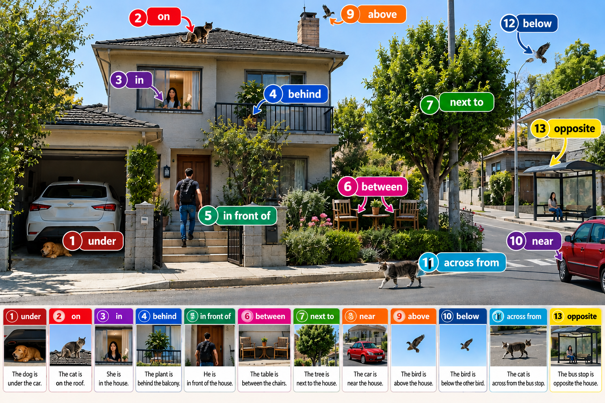

# Prepositions of place
---

	

## Prepositions of Place (حروف اضافه مکان)

|No.|Preposition|تلفظ فارسی|IPA|معنی|
|---|---|---|---|---|
|1|Under|آندِر|/ˈʌn.dər/|زیر|
|2|On|آن|/ɑːn/|روی|
|3|In|این|/ɪn/|داخل، درون|
|4|Behind|بیهایند|/bɪˈhaɪnd/|پشت|
|5|In front of|این فرانت آو|/ɪn ˈfrʌnt əv/|جلوی|
|6|Between|بیتوین|/bɪˈtwiːn/|بین دو چیز|
|7|Next to|نِکست تو|/ˈnekst tuː/|کنار، مجاور|
|8|Near|نیر|/nɪr/|نزدیک|
|9|Above|اَباو|/əˈbʌv/|بالاتر از|
|10|Below|بیلو|/bɪˈloʊ/|پایین‌تر از|
|11|Across from|اَکراس فرام|/əˈkrɔːs frəm/|روبه‌روی، آن‌طرف|
|12|Below|بیلو|/bɪˈloʊ/|پایین‌تر از|
|13|Opposite|آپِزیت|/ˈɑː.pə.zɪt/|روبه‌روی|

نکته: در تصویر شماره‌گذاری اشتباه کوچکی وجود دارد: شماره ۱۰ و ۱۲ هر دو برای Below استفاده شده‌اند و شماره ۸ فقط در ردیف پایین دیده می‌شود. جدول مطابق برچسب‌های خود تصویر تنظیم شده است.

## مثال‌های کاربردی بر اساس تصویر

|No.|English Sentence|ترجمه فارسی|
|---|---|---|
|1|The dog is under the car.|سگ زیر ماشین است.|
|2|The cat is on the roof.|گربه روی سقف است.|
|3|She is in the house.|او داخل خانه است.|
|4|The plant is behind the balcony.|گیاه پشت بالکن است.|
|5|He is in front of the house.|او جلوی خانه است.|
|6|The table is between the chairs.|میز بین صندلی‌هاست.|
|7|The tree is next to the house.|درخت کنار خانه است.|
|8|The car is near the house.|ماشین نزدیک خانه است.|
|9|The bird is above the house.|پرنده بالای خانه است.|
|10|The bird is below the other bird.|پرنده پایین‌تر از پرنده دیگر است.|
|11|The cat is across from the bus stop.|گربه آن طرف خیابان، روبه‌روی ایستگاه اتوبوس است.|
|12|Below|پایین‌تر از|
|13|The bus stop is opposite the house.|ایستگاه اتوبوس روبه‌روی خانه است.|

## تفاوت‌های مهمی که باید یاد بگیری

### 1. On و Above

- On: چیزی روی سطح دیگری قرار دارد و معمولاً با آن تماس دارد.
    
- Above: چیزی بالاتر از چیز دیگر است و لزوماً با آن تماس ندارد.
    

مثال:

The book is on the table. → کتاب روی میز است.

The lamp is above the table. → چراغ بالای میز است.

### 2. Under و Below

- Under: زیر چیزی، معمولاً در راستای عمودی آن.
    
- Below: پایین‌تر از یک چیز یا سطح.
    

مثال:

The cat is under the chair. → گربه زیر صندلی است.

The temperature is below zero. → دما زیر صفر است.

### 3. Next to و Near

- Next to: دقیقاً کنار چیزی.
    
- Near: نزدیک چیزی، اما نه لزوماً درست کنارش.
    

مثال:

The bank is next to the school. → بانک کنار مدرسه است.

The bank is near the school. → بانک نزدیک مدرسه است.

### 4. Opposite و Across from

هر دو می‌توانند معنی «روبه‌روی» بدهند.

The bank is opposite the hospital.

The bank is across from the hospital.

هر دو یعنی بانک روبه‌روی بیمارستان است. `Across from` به‌ویژه در انگلیسی آمریکایی رایج است.

## ساختار گرامری Prepositions of Place

فرمول اصلی:

Subject + am/is/are + Preposition of Place + Noun

مثال:

The cat is under the table.

- The cat → فاعل (Subject)
    
- is → فعل (Verb)
    
- under → حرف اضافه مکان (Preposition)
    
- the table → گروه اسمی (Noun Phrase)
    

یک نکته مهم: برای بیان وجود داشتن چیزی در یک مکان، از `There is` و `There are` هم استفاده می‌کنیم.

There is a cat under the table.

یک گربه زیر میز وجود دارد.

There are two chairs next to the table.

دو صندلی کنار میز وجود دارد.

این جدول و مثال‌ها برای تمرین گرامر Prepositions of Place در سطح A1 و A2 مناسب هستند.
