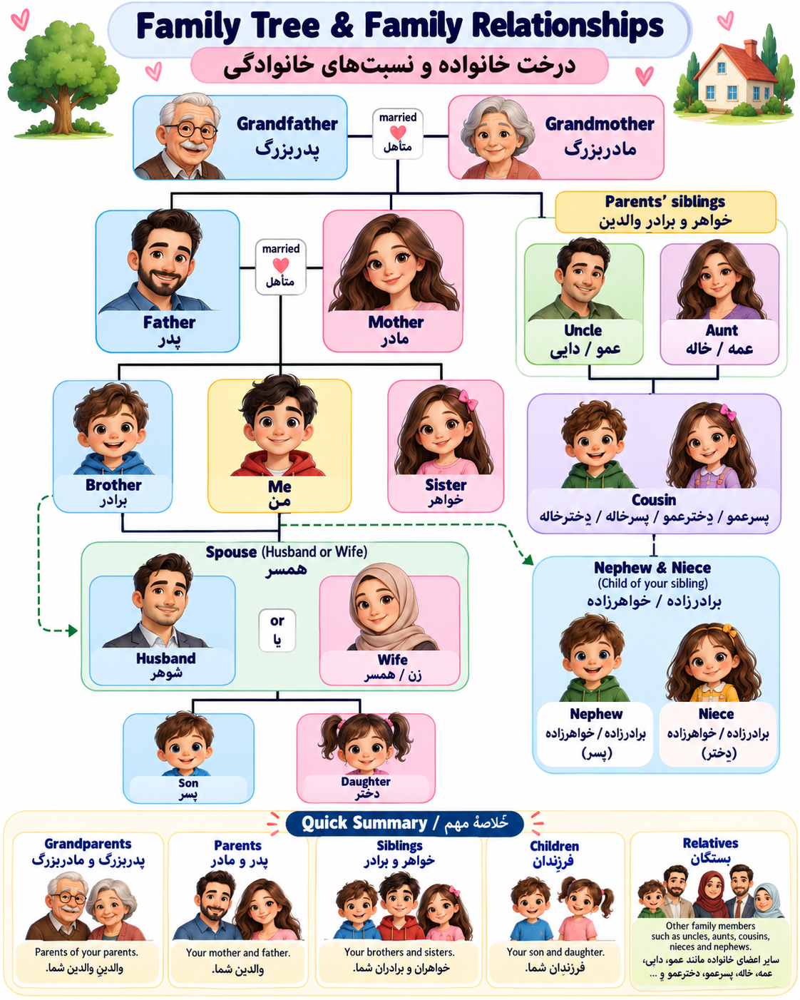

	

---

## 1. Family Members (اعضای خانواده)

|No.|English|تلفظ فارسی|معنی|
|---|---|---|---|
|1|Father|فادِر|پدر|
|2|Mother|مادِر|مادر|
|3|Parents|پِرِنتس|پدر و مادر|
|4|Brother|برادِر|برادر|
|5|Sister|سیستِر|خواهر|
|6|Siblings|سیبلینگز|خواهر و برادر|
|7|Son|سان|پسرِ شخص|
|8|Daughter|داتِر|دخترِ شخص|
|9|Children|چیلدرِن|فرزندان|
|10|Husband|هازبِند|شوهر|
|11|Wife|وایف|همسر (زن)|
|12|Spouse|اِسپَوس|همسر (زن یا شوهر)|

## 2. Grandparents (پدربزرگ و مادربزرگ)

|No.|English|تلفظ فارسی|معنی|
|---|---|---|---|
|13|Grandfather|گْرَندفادِر|پدربزرگ|
|14|Grandmother|گْرَندمادِر|مادربزرگ|
|15|Grandparents|گْرَندپِرِنتس|پدربزرگ و مادربزرگ|
|16|Grandson|گْرَندسان|نوه پسر|
|17|Granddaughter|گْرَندداتِر|نوه دختر|
|18|Grandchildren|گْرَندچیلدرِن|نوه‌ها|

## 3. Relatives (بستگان)

|No.|English|تلفظ فارسی|معنی|
|---|---|---|---|
|19|Uncle|آنکِل|عمو / دایی|
|20|Aunt|اَنت|عمه / خاله|
|21|Cousin|کازِن|پسرعمو، دخترعمو، پسردایی، دختردایی، پسرخاله، دخترخاله، پسرعمه، دخترعمه|
|22|Nephew|نِفیو|برادرزاده یا خواهرزاده پسر|
|23|Niece|نیس|برادرزاده یا خواهرزاده دختر|
|24|Relatives|رِلِتیوز|بستگان|
|25|Family|فَمِلی|خانواده|

## 4. تفاوت‌های خیلی مهم

Brother / Sister / Siblings

- Brother → فقط برادر
    
- Sister → فقط خواهر
    
- Siblings → خواهرها و برادرها، بدون مشخص کردن جنسیت
    

مثال:

I have two siblings.

من دو خواهر یا برادر دارم.

Uncle / Aunt / Cousin

- Uncle → عمو یا دایی
    
- Aunt → عمه یا خاله
    
- Cousin → فرزند عمو، عمه، خاله یا دایی
    

در انگلیسی برای پسرعمو و دخترخاله کلمات جداگانه‌ای نداریم و هر دو می‌تونن Cousin باشند.

Nephew / Niece

- Nephew → پسرِ برادر یا خواهر شما
    
- Niece → دخترِ برادر یا خواهر شما
    

## 5. چند جمله مهم برای Speaking

|English Sentence|معنی فارسی|
|---|---|
|This is my father.|این پدر من است.|
|My mother is very kind.|مادرم خیلی مهربان است.|
|I have one brother and two sisters.|من یک برادر و دو خواهر دارم.|
|My uncle lives in Tehran.|عمو یا دایی من در تهران زندگی می‌کند.|
|My cousin is a student.|پسرعمو، دخترعمو یا یکی دیگر از فرزندان عمو، عمه، خاله یا دایی من دانش‌آموز است.|
|My grandparents live in Shiraz.|پدربزرگ و مادربزرگم در شیراز زندگی می‌کنند.|
|My sister has a daughter.|خواهرم یک دختر دارد.|
|My niece is five years old.|خواهرزاده یا برادرزاده دخترم پنج سال دارد.|

### نکته گرامری مهم

در انگلیسی برای معرفی نسبت خانوادگی معمولاً از صفات ملکی استفاده می‌کنیم:

My / Your / His / Her / Our / Their

مثلاً:

- My brother → برادر من
    
- Her sister → خواهر او
    
- His father → پدر او
    
- Their grandparents → پدربزرگ و مادربزرگ آن‌ها
    

و یک نکته برای تلفظ: در کلماتی مثل Father، Mother و Brother، صدای `th` به صورت /ð/ تلفظ می‌شود، یعنی زبان کمی بین دندان‌ها قرار می‌گیرد و صدا تولید می‌کنیم.

با یاد گرفتن این ۲۵ کلمه، بخش اصلی واژگان مربوط به خانواده رو برای سطح A1 و A2 پوشش می‌دی.
