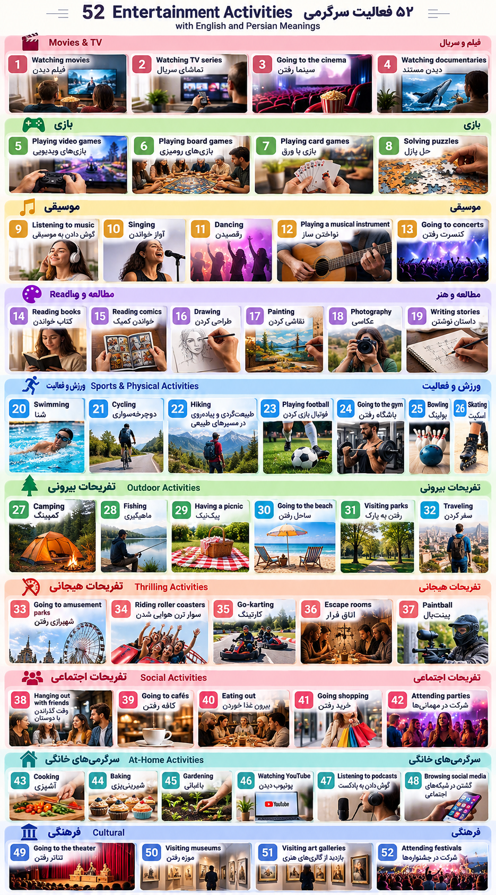

# Entertainment
---

	

## جدول شماره‌گذاری‌شده انواع سرگرمی‌ها (Types of Entertainment)

|شماره|دسته‌بندی|Entertainment|معنی فارسی|
|---|---|---|---|
|1|🎬 فیلم و سریال|Watching movies|فیلم دیدن|
|2|🎬 فیلم و سریال|Watching TV series|تماشای سریال|
|3|🎬 فیلم و سریال|Going to the cinema|سینما رفتن|
|4|🎬 فیلم و سریال|Watching documentaries|دیدن مستند|
|5|🎮 بازی|Playing video games|بازی‌های ویدیویی|
|6|🎮 بازی|Playing board games|بازی‌های رومیزی|
|7|🎮 بازی|Playing card games|بازی با ورق|
|8|🎮 بازی|Solving puzzles|حل پازل|
|9|🎵 موسیقی|Listening to music|گوش دادن به موسیقی|
|10|🎵 موسیقی|Singing|آواز خواندن|
|11|🎵 موسیقی|Dancing|رقصیدن|
|12|🎵 موسیقی|Playing a musical instrument|نواختن ساز|
|13|🎵 موسیقی|Going to concerts|کنسرت رفتن|
|14|📚 مطالعه و هنر|Reading books|کتاب خواندن|
|15|📚 مطالعه و هنر|Reading comics|خواندن کمیک|
|16|📚 مطالعه و هنر|Drawing|طراحی کردن|
|17|📚 مطالعه و هنر|Painting|نقاشی کردن|
|18|📚 مطالعه و هنر|Photography|عکاسی|
|19|📚 مطالعه و هنر|Writing stories|داستان نوشتن|
|20|🏃 ورزش و فعالیت|Swimming|شنا|
|21|🏃 ورزش و فعالیت|Cycling|دوچرخه‌سواری|
|22|🏃 ورزش و فعالیت|Hiking|طبیعت‌گردی و پیاده‌روی در مسیرهای طبیعی|
|23|🏃 ورزش و فعالیت|Playing football|فوتبال بازی کردن|
|24|🏃 ورزش و فعالیت|Going to the gym|باشگاه رفتن|
|25|🏃 ورزش و فعالیت|Bowling|بولینگ|
|26|🏃 ورزش و فعالیت|Skating|اسکیت|
|27|🌳 تفریحات بیرونی|Camping|کمپینگ|
|28|🌳 تفریحات بیرونی|Fishing|ماهیگیری|
|29|🌳 تفریحات بیرونی|Having a picnic|پیک‌نیک|
|30|🌳 تفریحات بیرونی|Going to the beach|ساحل رفتن|
|31|🌳 تفریحات بیرونی|Visiting parks|رفتن به پارک|
|32|🌳 تفریحات بیرونی|Traveling|سفر کردن|
|33|🎡 تفریحات هیجانی|Going to amusement parks|شهربازی رفتن|
|34|🎡 تفریحات هیجانی|Riding roller coasters|سوار ترن هوایی شدن|
|35|🎡 تفریحات هیجانی|Go-karting|کارتینگ|
|36|🎡 تفریحات هیجانی|Escape rooms|اتاق فرار|
|37|🎡 تفریحات هیجانی|Paintball|پینت‌بال|
|38|☕ تفریحات اجتماعی|Hanging out with friends|وقت گذراندن با دوستان|
|39|☕ تفریحات اجتماعی|Going to cafés|کافه رفتن|
|40|☕ تفریحات اجتماعی|Eating out|بیرون غذا خوردن|
|41|☕ تفریحات اجتماعی|Going shopping|خرید رفتن|
|42|☕ تفریحات اجتماعی|Attending parties|شرکت در مهمانی‌ها|
|43|🏠 سرگرمی‌های خانگی|Cooking|آشپزی|
|44|🏠 سرگرمی‌های خانگی|Baking|شیرینی‌پزی|
|45|🏠 سرگرمی‌های خانگی|Gardening|باغبانی|
|46|🏠 سرگرمی‌های خانگی|Watching YouTube|یوتیوب دیدن|
|47|🏠 سرگرمی‌های خانگی|Listening to podcasts|گوش دادن به پادکست|
|48|🏠 سرگرمی‌های خانگی|Browsing social media|گشتن در شبکه‌های اجتماعی|
|49|🎭 فرهنگی|Going to the theater|تئاتر رفتن|
|50|🎭 فرهنگی|Visiting museums|موزه رفتن|
|51|🎭 فرهنگی|Visiting art galleries|بازدید از گالری‌های هنری|
|52|🎭 فرهنگی|Attending festivals|شرکت در جشنواره‌ها|

---
## ساختن جمله با تمام سرگرمی هایه بالا

## 🎬 ۱. فیلم و سریال (Movies & TV)

|شماره|Entertainment|جمله انگلیسی|ترجمه فارسی|
|---|---|---|---|
|1|Watching movies|I enjoy watching movies at night.|من از فیلم دیدن در شب لذت می‌برم.|
|2|Watching TV series|I usually watch TV series after dinner.|من معمولاً بعد از شام سریال تماشا می‌کنم.|
|3|Going to the cinema|I like going to the cinema with my friends.|من دوست دارم با دوستانم به سینما بروم.|
|4|Watching documentaries|I enjoy watching documentaries about nature.|من از تماشای مستندهای طبیعت لذت می‌برم.|

## 🎮 ۲. بازی (Games)

|شماره|Entertainment|جمله انگلیسی|ترجمه فارسی|
|---|---|---|---|
|5|Playing video games|I play video games in my free time.|من در اوقات فراغتم بازی ویدیویی می‌کنم.|
|6|Playing board games|We enjoy playing board games together.|ما از انجام بازی‌های رومیزی با هم لذت می‌بریم.|
|7|Playing card games|I sometimes play card games with my family.|من گاهی با خانواده‌ام ورق‌بازی می‌کنم.|
|8|Solving puzzles|Solving puzzles helps me relax.|حل کردن پازل به من کمک می‌کند آرام شوم.|

## 🎵 ۳. موسیقی (Music)

|شماره|Entertainment|جمله انگلیسی|ترجمه فارسی|
|---|---|---|---|
|9|Listening to music|I love listening to music while walking.|من عاشق گوش دادن به موسیقی هنگام پیاده‌روی هستم.|
|10|Singing|I enjoy singing my favorite songs.|من از خواندن آهنگ‌های موردعلاقه‌ام لذت می‌برم.|
|11|Dancing|Dancing makes me happy.|رقصیدن مرا خوشحال می‌کند.|
|12|Playing a musical instrument|I want to learn to play a musical instrument.|من می‌خواهم نواختن یک ساز را یاد بگیرم.|
|13|Going to concerts|I like going to concerts with my friends.|من دوست دارم با دوستانم به کنسرت بروم.|

## 📚 ۴. مطالعه و هنر (Reading & Art)

|شماره|Entertainment|جمله انگلیسی|ترجمه فارسی|
|---|---|---|---|
|14|Reading books|I enjoy reading books before bed.|من از کتاب خواندن قبل از خواب لذت می‌برم.|
|15|Reading comics|My brother likes reading comics.|برادرم دوست دارد کمیک بخواند.|
|16|Drawing|Drawing is one of my favorite hobbies.|طراحی کردن یکی از سرگرمی‌های موردعلاقه من است.|
|17|Painting|I like painting beautiful landscapes.|من دوست دارم منظره‌های زیبا نقاشی کنم.|
|18|Photography|Photography helps me capture special moments.|عکاسی به من کمک می‌کند لحظه‌های خاص را ثبت کنم.|
|19|Writing stories|I enjoy writing stories in my free time.|من از داستان نوشتن در اوقات فراغتم لذت می‌برم.|

## 🏃 ۵. ورزش و فعالیت (Sports & Physical Activities)

|شماره|Entertainment|جمله انگلیسی|ترجمه فارسی|
|---|---|---|---|
|20|Swimming|I go swimming twice a week.|من هفته‌ای دو بار شنا می‌روم.|
|21|Cycling|I enjoy cycling in the park.|من از دوچرخه‌سواری در پارک لذت می‌برم.|
|22|Hiking|We usually go hiking on Fridays.|ما معمولاً جمعه‌ها به طبیعت‌گردی می‌رویم.|
|23|Playing football|I play football with my friends every weekend.|من هر آخر هفته با دوستانم فوتبال بازی می‌کنم.|
|24|Going to the gym|I go to the gym three times a week.|من هفته‌ای سه بار به باشگاه می‌روم.|
|25|Bowling|I sometimes go bowling with my friends.|من گاهی با دوستانم به بولینگ می‌روم.|
|26|Skating|My sister enjoys skating in the park.|خواهرم از اسکیت کردن در پارک لذت می‌برد.|

## 🌳 ۶. تفریحات بیرونی (Outdoor Activities)

|شماره|Entertainment|جمله انگلیسی|ترجمه فارسی|
|---|---|---|---|
|27|Camping|We go camping in the mountains every summer.|ما هر تابستان در کوهستان کمپ می‌زنیم.|
|28|Fishing|My father enjoys fishing at the lake.|پدرم از ماهیگیری در دریاچه لذت می‌برد.|
|29|Having a picnic|We usually have a picnic on weekends.|ما معمولاً آخر هفته‌ها پیک‌نیک می‌رویم.|
|30|Going to the beach|I love going to the beach in summer.|من عاشق ساحل رفتن در تابستان هستم.|
|31|Visiting parks|I enjoy visiting parks with my family.|من از رفتن به پارک با خانواده‌ام لذت می‌برم.|
|32|Traveling|Traveling helps me learn about different cultures.|سفر کردن به من کمک می‌کند با فرهنگ‌های مختلف آشنا شوم.|

## 🎡 ۷. تفریحات هیجانی (Thrilling Activities)

|شماره|Entertainment|جمله انگلیسی|ترجمه فارسی|
|---|---|---|---|
|33|Going to amusement parks|I enjoy going to amusement parks with my friends.|من از شهربازی رفتن با دوستانم لذت می‌برم.|
|34|Riding roller coasters|I love riding roller coasters because they are exciting.|من عاشق سوار شدن بر ترن هوایی هستم، چون هیجان‌انگیز است.|
|35|Go-karting|I want to try go-karting this weekend.|من می‌خواهم این آخر هفته کارتینگ را امتحان کنم.|
|36|Escape rooms|We enjoy solving mysteries in escape rooms.|ما از حل کردن معماها در اتاق‌های فرار لذت می‌بریم.|
|37|Paintball|Playing paintball is exciting and fun.|پینت‌بال بازی کردن هیجان‌انگیز و سرگرم‌کننده است.|

## ☕ ۸. تفریحات اجتماعی (Social Activities)

|شماره|Entertainment|جمله انگلیسی|ترجمه فارسی|
|---|---|---|---|
|38|Hanging out with friends|I love hanging out with my friends after work.|من عاشق وقت گذراندن با دوستانم بعد از کار هستم.|
|39|Going to cafés|I enjoy going to cafés on weekends.|من از کافه رفتن در آخر هفته‌ها لذت می‌برم.|
|40|Eating out|We usually eat out on Friday nights.|ما معمولاً شب‌های جمعه بیرون غذا می‌خوریم.|
|41|Going shopping|I like going shopping with my sister.|من دوست دارم با خواهرم به خرید بروم.|
|42|Attending parties|I enjoy attending parties and meeting new people.|من از شرکت در مهمانی‌ها و آشنا شدن با افراد جدید لذت می‌برم.|

## 🏠 ۹. سرگرمی‌های خانگی (At-Home Activities)

|شماره|Entertainment|جمله انگلیسی|ترجمه فارسی|
|---|---|---|---|
|43|Cooking|I enjoy cooking dinner for my family.|من از درست کردن شام برای خانواده‌ام لذت می‌برم.|
|44|Baking|My mother loves baking cakes.|مادرم عاشق کیک پختن است.|
|45|Gardening|Gardening helps me feel relaxed.|باغبانی به من کمک می‌کند احساس آرامش کنم.|
|46|Watching YouTube|I usually watch YouTube videos in my free time.|من معمولاً در اوقات فراغتم ویدیوهای یوتیوب تماشا می‌کنم.|
|47|Listening to podcasts|I enjoy listening to podcasts while driving.|من از گوش دادن به پادکست هنگام رانندگی لذت می‌برم.|
|48|Browsing social media|I spend some time browsing social media every day.|من هر روز مقداری از وقتم را صرف گشتن در شبکه‌های اجتماعی می‌کنم.|

## 🎭 ۱۰. فعالیت‌های فرهنگی (Cultural Activities)

|شماره|Entertainment|جمله انگلیسی|ترجمه فارسی|
|---|---|---|---|
|49|Going to the theater|I enjoy going to the theater to watch plays.|من از تئاتر رفتن برای تماشای نمایش‌ها لذت می‌برم.|
|50|Visiting museums|I like visiting museums when I travel.|من دوست دارم هنگام سفر از موزه‌ها بازدید کنم.|
|51|Visiting art galleries|I enjoy visiting art galleries and looking at paintings.|من از بازدید گالری‌های هنری و تماشای نقاشی‌ها لذت می‌برم.|
|52|Attending festivals|We enjoy attending festivals in our city.|ما از شرکت در جشنواره‌های شهرمان لذت می‌بریم.|

## نکته گرامری خیلی مهم

در جدول بالا چند ساختار کاربردی تکرار شده است:

|ساختار|مثال|
|---|---|
|Enjoy + verb-ing|I enjoy swimming.|
|Like + verb-ing|I like reading books.|
|Love + verb-ing|I love dancing.|
|Go + verb-ing|I go swimming.|
|Want to + verb|I want to travel.|

به تفاوت این دو جمله دقت کن:

I enjoy swimming.  
من از شنا کردن لذت می‌برم.

I go swimming twice a week.  
من هفته‌ای دو بار شنا می‌روم.

در جمله اول روی علاقه تأکید داریم و در جمله دوم درباره انجام دادن یک فعالیت صحبت می‌کنیم.

نتیجه: حالا ۵۲ سرگرمی داری و برای هرکدام یک جمله کاربردی انگلیسی همراه با ترجمه فارسی. این مجموعه برای تمرین مکالمه درباره Free Time, Hobbies & Entertainment خیلی مناسب است.

---

## چند جمله کاربردی برای مکالمه انگلیسی

What do you do for entertainment?

برای سرگرمی چه کار می‌کنی؟

I usually watch movies or hang out with my friends.

من معمولاً فیلم می‌بینم یا با دوستانم وقت می‌گذرونم.

My favorite form of entertainment is playing video games.

سرگرمی موردعلاقه من بازی‌های ویدیویی است.

I enjoy going to the cinema on weekends.

من از سینما رفتن در آخر هفته‌ها لذت می‌برم.

---

## نکته گرامری

کلمه Entertainment معمولاً اسم غیرقابل‌شمارش (Uncountable noun) است.

|عبارت|معنی فارسی|
|---|---|
|Types of entertainment|انواع سرگرمی|
|Forms of entertainment|شکل‌های مختلف سرگرمی|
|Entertainment activities|فعالیت‌های سرگرم‌کننده|

مجموع: ۵۲ سرگرمی رایج در ۱۰ دسته‌بندی مختلف ✅
