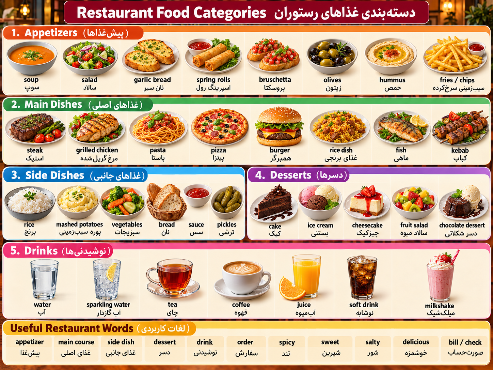

# Restaurant food categories
----

	

## 1. Appetizers – پیش‌غذاها 🥗

|English|فارسی|تلفظ فارسی|
|---|---|---|
|Appetizer|پیش‌غذا|اَپِتایزِر|
|Starter|پیش‌غذا|اِستارتِر|
|Soup|سوپ|سوپ|
|Salad|سالاد|سَلِد|
|Garlic bread|نان سیر|گارلیک بِرِد|
|Spring rolls|اسپرینگ رول|اِسپرینگ رولز|
|Bruschetta|بروشتا|بروسکِتا|
|Olives|زیتون|آلیوز|
|Hummus|حمص|هوموس|
|Fries / Chips|سیب‌زمینی سرخ‌کرده|فرایز / چیپس|

## 2. Main Dishes – غذاهای اصلی 🍔

|English|فارسی|تلفظ فارسی|
|---|---|---|
|Main dish|غذای اصلی|مِین دیش|
|Main course|غذای اصلی|مِین کورس|
|Steak|استیک|اِستِیک|
|Grilled chicken|مرغ گریل‌شده|گریلْد چیکِن|
|Pasta|پاستا|پَستا|
|Pizza|پیتزا|پیتسا|
|Burger|همبرگر|بِرگِر|
|Rice dish|غذای برنجی|رایس دیش|
|Fish|ماهی|فیش|
|Kebab|کباب|کِباب|
|Seafood|غذای دریایی|سی‌فود|

## 3. Side Dishes – غذاهای جانبی 🍟

|English|فارسی|تلفظ فارسی|
|---|---|---|
|Side dish|غذای جانبی|ساید دیش|
|Rice|برنج|رایس|
|Mashed potatoes|پوره سیب‌زمینی|مَشت پِتِیتوز|
|Vegetables|سبزیجات|وِجتِبِلز|
|Bread|نان|بِرِد|
|Sauce|سس|سوس|
|Pickles|ترشی|پیکِلز|
|French fries|سیب‌زمینی سرخ‌کرده|فرِنچ فرایز|

## 4. Desserts – دسرها 🍰

|English|فارسی|تلفظ فارسی|
|---|---|---|
|Dessert|دسر|دیزِرت|
|Cake|کیک|کِیک|
|Ice cream|بستنی|آیس کریم|
|Cheesecake|چیزکیک|چیزکِیک|
|Fruit salad|سالاد میوه|فروت سَلِد|
|Chocolate dessert|دسر شکلاتی|چاکلِت دیزِرت|
|Pudding|پودینگ|پودینگ|
|Brownie|براونی|براونی|

## 5. Drinks / Beverages – نوشیدنی‌ها 🥤

|English|فارسی|تلفظ فارسی|
|---|---|---|
|Drink|نوشیدنی|درینک|
|Beverage|نوشیدنی|بِوِریج|
|Water|آب|ووتِر|
|Still water|آب بدون گاز|اِستیل ووتِر|
|Sparkling water|آب گازدار|اِسپارکلینگ ووتِر|
|Tea|چای|تی|
|Coffee|قهوه|کافی|
|Juice|آب‌میوه|جوس|
|Orange juice|آب پرتقال|آرِنج جوس|
|Soft drink|نوشابه|سافت درینک|
|Milkshake|میلک‌شیک|میلک‌شِیک|
|Smoothie|اسموتی|اِسموذی|
|Lemonade|لیموناد|لِمِنِید|

## 6. Useful Restaurant Words – لغات کاربردی رستوران

|English|فارسی|تلفظ فارسی|
|---|---|---|
|Menu|منو|مِنیو|
|Order|سفارش دادن|اُردِر|
|Waiter|پیشخدمت مرد|وِیتِر|
|Waitress|پیشخدمت زن|وِیترِس|
|Chef|سرآشپز|شِف|
|Bill|صورت‌حساب|بیل|
|Reservation|رزرو|رِزِوِیشِن|
|Spicy|تند|اِسپایسی|
|Sweet|شیرین|سوییت|
|Salty|شور|سالتی|
|Sour|ترش|ساوِر|
|Delicious|خوشمزه|دیلیشِس|
|Vegetarian|گیاه‌خوار / گیاهی|وِجِتِریَن|
|Takeaway|غذای بیرون‌بر|تِیک‌اِوِی|
|Tip|انعام|تیپ|

### ⭐ چند تفاوت مهم که باید حفظ کنی

Dessert vs Desert

- Dessert (دیزِرت) = دسر
    
- Desert (دِزِت) = بیابان
    

Chips vs Crisps در انگلیسی بریتانیایی:

- Chips = سیب‌زمینی سرخ‌کرده
    
- Crisps = چیپس بسته‌بندی‌شده
    

Appetizer vs Starter  

-----
## جملات کاربردی

## 1. Entering a Restaurant – ورود به رستوران

|English|فارسی|تلفظ فارسی|
|---|---|---|
|Do you have a reservation?|آیا رزرو دارید؟|دو یو هَو اِ رِزِوِیشِن؟|
|I have a reservation.|من رزرو دارم.|آی هَو اِ رِزِوِیشِن|
|A table for two, please.|یک میز برای دو نفر لطفاً.|اِ تِیبِل فور تو، پلیز|
|Do you have a free table?|میز خالی دارید؟|دو یو هَو اِ فری تِیبِل؟|
|Can we sit by the window?|می‌توانیم کنار پنجره بنشینیم؟|کَن وی سیت بای دِ ویندو؟|

## 2. Ordering Food – سفارش غذا

|English|فارسی|تلفظ فارسی|
|---|---|---|
|Can I see the menu, please?|می‌توانم منو را ببینم؟|کَن آی سی دِ مِنیو، پلیز؟|
|Are you ready to order?|آماده سفارش هستید؟|آ یو رِدی تو اُردِر؟|
|I'd like a pizza, please.|یک پیتزا می‌خواهم، لطفاً.|آید لایک اِ پیتسا، پلیز|
|What do you recommend?|چه چیزی پیشنهاد می‌کنید؟|وات دو یو رِکِمِند؟|
|I'll have the chicken.|من مرغ سفارش می‌دهم.|آیل هَو دِ چیکِن|
|Can I have some water?|می‌توانم کمی آب داشته باشم؟|کَن آی هَو سام ووتِر؟|
|What comes with this dish?|همراه این غذا چی سرو می‌شود؟|وات کامز ویذ دیس دیش؟|

## 3. Asking About Food – پرسیدن درباره غذا

|English|فارسی|تلفظ فارسی|
|---|---|---|
|Is this dish spicy?|این غذا تند است؟|ایز دیس دیش اِسپایسی؟|
|Is it vegetarian?|این غذا گیاهی است؟|ایز ایت وِجِتِریَن؟|
|Does it contain nuts?|آیا مغزها دارد؟|داز ایت کِنتِین ناتس؟|
|I'm allergic to peanuts.|به بادام‌زمینی حساسیت دارم.|آیم اَلِجیک تو پیناتس|
|Can I have it without onions?|می‌توانم بدون پیاز سفارش بدهم؟|کَن آی هَو ایت ویذاوت آنیِنز؟|
|How long will it take?|چقدر طول می‌کشد؟|هاو لانگ ویل ایت تِیک؟|

## 4. During the Meal – هنگام غذا خوردن

|English|فارسی|تلفظ فارسی|
|---|---|---|
|Enjoy your meal!|نوش جان!|اِنجوی یور میل!|
|The food is delicious.|غذا خوشمزه است.|دِ فود ایز دیلیشِس|
|Everything is perfect.|همه‌چیز عالی است.|اِوری‌ثینگ ایز پِرفِکت|
|Could I have another fork?|می‌توانم یک چنگال دیگر داشته باشم؟|کود آی هَو اَناذِر فورک؟|
|Excuse me!|ببخشید!|اِکسکیوز می!|
|This isn't what I ordered.|این چیزی نیست که سفارش دادم.|دیس ایزِنت وات آی اُردِرد|
|Could we have some more bread?|می‌توانیم کمی نان بیشتر داشته باشیم؟|کود وی هَو سام مور بِرِد؟|

## 5. Paying the Bill – پرداخت صورت‌حساب

|English|فارسی|تلفظ فارسی|
|---|---|---|
|Can I have the bill, please?|صورت‌حساب را می‌دهید لطفاً؟|کَن آی هَو دِ بیل، پلیز؟|
|Can I pay by card?|می‌توانم با کارت پرداخت کنم؟|کَن آی پِی بای کارد؟|
|Can we split the bill?|می‌توانیم حساب را تقسیم کنیم؟|کَن وی اِسپلیت دِ بیل؟|
|Is service included?|هزینه خدمات حساب شده است؟|ایز سِرویس اینکلودِد؟|
|Keep the change.|بقیه پول برای خودتان.|کیپ دِ چِینج|
|Can I get this to take away?|می‌توانم این را بیرون‌بر بگیرم؟|کَن آی گِت دیس تو تِیک اَوِی؟|