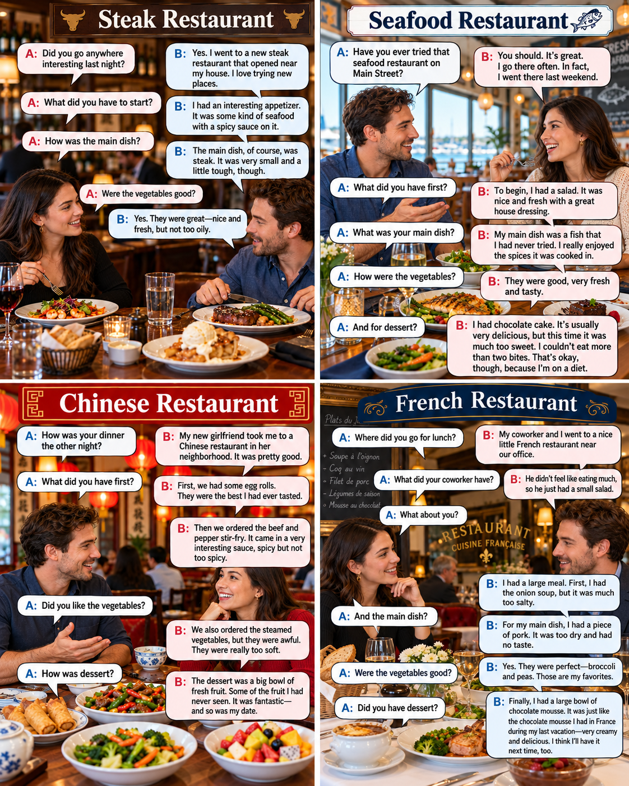

# page 52 track 26
---

	

 

## Listening 3 – Full Transcript

### 1. Steak Restaurant

I went to a new steak restaurant last night that opened near my house. I love trying new places.

To start the meal, I had an interesting appetizer. It was some kind of seafood with a spicy sauce on it. Mmm.

The main dish, of course, was steak. It was very small and a little tough, though. However, the vegetables were great. Nice and fresh, but not too oily.

The final thing was the best, the dessert. It was apple pie with a lot of ice cream on it.

I know that I shouldn't eat so many sweets, but it was delicious!

### 2. Seafood Restaurant

Have you ever tried that seafood restaurant on Main Street? You should. It's great. I go there often.

In fact, I went there last weekend. To begin, I had a salad. It was nice and fresh with a great house dressing.

My main dish was a fish that I had never tried. I really enjoyed the spices it was cooked in.

The vegetables were good, very fresh and tasty.

For dessert, I had chocolate cake. It's usually very delicious, but this time it was much too sweet.

I couldn't eat more than two bites. That's okay, though, because I'm on a diet.

### 3. Chinese Restaurant

My new girlfriend took me to a Chinese restaurant in her neighborhood the other night. It was pretty good.

First, we had some egg rolls. They were the best I had ever tasted.

Then we ordered the beef and pepper stir-fry. It came in a very interesting sauce, spicy but not too spicy.

We also ordered the steamed vegetables, but they were awful. They were really too soft.

The dessert was a big bowl of fresh fruit. Some of the fruit I had never seen.

It was fantastic, and so was my date.

### 4. French Restaurant

For lunch, my coworker and I went to a nice little French restaurant near our office.

He didn't feel like eating much, so he just had a small salad.

I had a large meal, though. First, I had the onion soup, but it was much too salty.

For my main dish, I had a piece of pork. It was too dry and had no taste.

The vegetables were perfect, though. Broccoli and peas. Those are my favorites.

Finally, I had a large bowl of chocolate mousse.

It was just like the chocolate mousse I had in France during my last vacation. Very creamy and delicious.

I think I'll have it next time, too.

## لغات مهم این لیسنینگ

| English            | معنی فارسی         |
| ------------------ | ------------------ |
| Appetizer          | پیش‌غذا            |
| Main dish          | غذای اصلی          |
| Seafood            | غذای دریایی        |
| Spicy sauce        | سس تند             |
| Tough              | سفت، سخت‌جویدنی    |
| Oily               | چرب                |
| Dessert            | دسر                |
| House dressing     | سس مخصوص رستوران   |
| Tasty              | خوشمزه             |
| Too sweet          | بیش از حد شیرین    |
| Bites              | لقمه‌ها            |
| On a diet          | در رژیم غذایی بودن |
| Egg rolls          | رول تخم‌مرغ        |
| Stir-fry           | تفت‌دادنی          |
| Steamed vegetables | سبزیجات بخارپز     |
| Awful              | افتضاح             |
| Salty              | شور                |
| Pork               | گوشت خوک           |
| Broccoli           | کلم بروکلی         |
| Peas               | نخودفرنگی          |
| Chocolate mousse   | موس شکلاتی         |
| Creamy             | خامه‌ای            |
| Delicious          | بسیار خوشمزه       |

---
## 1. Steak Restaurant | رستوران استیک

1. I went to a new steak restaurant last night that opened near my house.

دیشب به یک رستوران استیک جدید رفتم که نزدیک خانه‌ام افتتاح شده بود.

2. I love trying new places.

من عاشق امتحان کردن مکان‌های جدید هستم.

3. To start the meal, I had an interesting appetizer.

برای شروع غذا، یک پیش‌غذای جالب خوردم.

4. It was some kind of seafood with a spicy sauce on it.

نوعی غذای دریایی بود که روی آن سس تند ریخته بودند.

5. Mmm.

اِمم! (صدای لذت بردن از غذا)

6. The main dish, of course, was steak.

غذای اصلی، البته، استیک بود.

7. It was very small and a little tough, though.

البته خیلی کوچک و کمی سفت بود.

8. However, the vegetables were great.

با این حال، سبزیجات عالی بودند.

9. Nice and fresh, but not too oily.

خوب و تازه بودند، اما بیش از حد چرب نبودند.

10. The final thing was the best, the dessert.

آخرین بخش غذا بهترین قسمت بود، یعنی دسر.

11. It was apple pie with a lot of ice cream on it.

پای سیب بود که مقدار زیادی بستنی روی آن داشت.

12. I know that I shouldn't eat so many sweets, but it was delicious!

می‌دانم که نباید این‌قدر شیرینی بخورم، اما واقعاً خوشمزه بود!

## 2. Seafood Restaurant | رستوران غذاهای دریایی

1. Have you ever tried that seafood restaurant on Main Street?

تا حالا آن رستوران غذاهای دریایی در خیابان اصلی را امتحان کرده‌ای؟

2. You should.

باید امتحانش کنی.

3. It's great.

عالیه!

4. I go there often.

من اغلب به آنجا می‌روم.

5. In fact, I went there last weekend.

در واقع، آخر هفته گذشته به آنجا رفتم.

6. To begin, I had a salad.

برای شروع، یک سالاد خوردم.

7. It was nice and fresh with a great house dressing.
   <mark>House dressing یعنی سس مخصوص رستوران 🥗

یعنی سسی که خود رستوران تهیه می‌کنه و معمولاً دستور مخصوص خودش رو داره.</mark>

سالاد خوب و تازه بود و یک سس مخصوص رستورانِ عالی داشت.

8. My main dish was a fish that I had never tried.

غذای اصلی من نوعی ماهی بود که قبلاً هرگز امتحان نکرده بودم.

9. I really enjoyed the spices it was cooked in.

من واقعاً از ادویه‌هایی که ماهی با آن‌ها پخته شده بود لذت بردم.

10. The vegetables were good, very fresh and tasty.

سبزیجات خوب بودند، خیلی تازه و خوش‌طعم.

11. For dessert, I had chocolate cake.

برای دسر، کیک شکلاتی خوردم.

12. It's usually very delicious, but this time it was much too sweet.

معمولاً خیلی خوشمزه است، اما این بار بیش از حد شیرین بود.

13. I couldn't eat more than two bites.

نتوانستم بیشتر از دو لقمه بخورم.

14. That's okay, though, because I'm on a diet.

البته اشکالی ندارد، چون رژیم غذایی دارم.

## 3. Chinese Restaurant | رستوران چینی

1. My new girlfriend took me to a Chinese restaurant in her neighborhood the other night.

چند شب پیش، دوست‌دختر جدیدم مرا به یک رستوران چینی در محله خودش برد.

2. It was pretty good.

نسبتاً خوب بود.

3. First, we had some egg rolls.

اول چند رول تخم‌مرغ خوردیم.

4. They were the best I had ever tasted.

آن‌ها بهترین رول‌هایی بودند که تا آن موقع خورده بودم.

5. Then we ordered the beef and pepper stir-fry.

بعد غذای گوشت گاو و فلفل تفت‌داده‌شده سفارش دادیم.

6. It came in a very interesting sauce, spicy but not too spicy.

با یک سس خیلی جالب سرو شد؛ تند بود، اما نه بیش از حد تند.

7. We also ordered the steamed vegetables, but they were awful.

سبزیجات بخارپز هم سفارش دادیم، اما افتضاح بودند.

8. They were really too soft.

واقعاً بیش از حد نرم بودند.

9. The dessert was a big bowl of fresh fruit.

دسر یک کاسه بزرگ میوه تازه بود.

10. Some of the fruit I had never seen.

بعضی از آن میوه‌ها را قبلاً هرگز ندیده بودم.

11. It was fantastic.

فوق‌العاده بود.

12. And so was my date.

و کسی هم که با او قرار عاشقانه داشتم، فوق‌العاده بود.

نکته: اینجا Date به معنی «قرار عاشقانه» یا «فردی که با او قرار داری» است، نه تاریخ یا خرما!

## 4. French Restaurant | رستوران فرانسوی

1. For lunch, my coworker and I went to a nice little French restaurant near our office.

برای ناهار، من و همکارم به یک رستوران فرانسوی کوچک و خوب نزدیک دفتر کارمان رفتیم.

2. He didn't feel like eating much, so he just had a small salad.

او خیلی میل به غذا خوردن نداشت، بنابراین فقط یک سالاد کوچک خورد.

3. I had a large meal, though.

اما من یک وعده غذای مفصل خوردم.

4. First, I had the onion soup, but it was much too salty.

اول سوپ پیاز خوردم، اما خیلی بیش از حد شور بود.

5. For my main dish, I had a piece of pork.

برای غذای اصلی، یک تکه گوشت خوک خوردم.

6. It was too dry and had no taste.

بیش از حد خشک بود و هیچ مزه‌ای نداشت.

7. The vegetables were perfect, though.

البته سبزیجات عالی بودند.

8. Broccoli and peas.

کلم بروکلی و نخودفرنگی.

9. Those are my favorites.

این‌ها سبزیجات مورد علاقه من هستند.

10. Finally, I had a large bowl of chocolate mousse.

در نهایت، یک کاسه بزرگ موس شکلاتی خوردم.

11. It was just like the chocolate mousse I had in France during my last vacation.

دقیقاً شبیه موس شکلاتی‌ای بود که در آخرین تعطیلاتم در فرانسه خورده بودم.

12. Very creamy and delicious.

خیلی خامه‌ای و خوشمزه بود.

13. I think I'll have it next time, too.

فکر می‌کنم دفعه بعد هم آن را سفارش بدهم.

## چند ساختار مهم که از این Listening باید یاد بگیری

|عبارت انگلیسی|معنی فارسی|
|---|---|
|I love trying...|عاشق امتحان کردنِ ... هستم|
|Have you ever tried...?|آیا تا حالا ... را امتحان کرده‌ای؟|
|I had never tried...|قبلاً هرگز ... را امتحان نکرده بودم|
|To start the meal|برای شروع غذا|
|To begin|برای شروع|
|Of course|البته، مسلماً|
|However|با این حال|
|Though|البته، با این وجود|
|In fact|در واقع|
|Much too sweet|خیلی بیش از حد شیرین|
|I couldn't eat...|نتوانستم ... بخورم|
|I'm on a diet|رژیم غذایی دارم|
|Feel like eating|میل به غذا خوردن داشتن|
|It was just like...|درست مثل ... بود|
|And so was my date|و همراه من هم همین‌طور بود|

یک نکته خیلی مهم: هر چهار بخش بیشتر درباره توصیف غذا از نظر طعم، کیفیت، تازگی، بافت و میزان چربی هستند. اگر این صفات را خوب یاد بگیری، هم در Listening و هم در مکالمه انگلیسی درباره رستوران‌ها خیلی به کارت می‌آیند.
